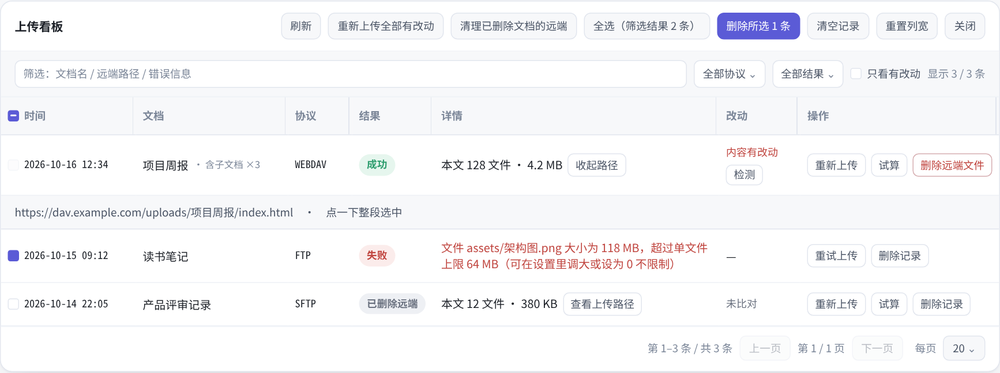

  

<h1 align="center">Netglimmer 上传</h1>

  把思源笔记文档传到 WebDAV / FTP / SFTP 服务器或本地目录 
  一次右键，按 HTML、Markdown 或 Word 导出并上传；增量、校验与看板齐全。

  
  
  
  

  <strong>简体中文</strong> ·
  <a href="README_en.md">English</a> ·
  <a href="README_zh_CN.md">完整中文手册</a> ·
  <a href="README_en_US.md">Full English manual</a>

  

在思源文档树里右键一篇文档，插件按当前设置导出，上传到服务器或本地目录，读回校验，再把结果记进上传看板。重复上传默认走增量，只传有变化的文件。

| 能力 | 说明 |
|---|---|
| **三种格式** | HTML (SiYuan) 整页、Markdown 正文与引用资源、单个自包含 Word (.docx) |
| **增量上传** | 服务器上已有的运行时文件直接跳过；改名、移动留下的旧目录自动清理 |
| **改动检测** | 文档再次编辑后，右键菜单多出「检测到改动，重新上传」 |
| **试算与校验** | 上传前先看文件数与体积，上传后读回比对；失败可重试，进行中可取消 |
| **上传看板** | 搜索、筛选、排序、翻页、批量重传与远端清理，路径可就地展开 |
| **三个入口** | 文档树右键、命令面板、状态栏；默认不绑定快捷键 |

## 三种导出格式

| 格式 | 远端目录里有什么 | 适合 |
|---|---|---|
| **HTML (SiYuan)** · 推荐 | `<文档名>/index.html`、`stage/` 与 `appearance/` 运行时、正文引用的 `assets/` | 直接当完整网页打开：主题、代码高亮、双链、块引用、块嵌入、图片都在，还可注入侧边大纲 |
| **Markdown** | `<文档名>.md` 与正文真正引用到的 `assets/` | 喂给静态站点生成器或 Markdown 阅读器 |
| **Word (.docx)** | 单个自包含的 `<文档名>.docx`，图片已内嵌 | 交给 Word / WPS 继续编辑，或作为附件发出 |

> HTML 档的 `index.html` 与手动「导出 → HTML (SiYuan)」逐字节一致；Markdown 与 Word 档直接使用思源内核的导出结果。

## 四种传输方式

| 协议 | 说明 |
|---|---|
| **WebDAV** · 推荐 | 经思源内核的 HTTP 代理访问；标准 WebDAV 服务即可，不需要额外客户端 |
| **FTP** | 内置纯 JS 客户端，PASV 模式；自动识别 UTF-8，老服务器回退 GBK 路径 |
| **SFTP** | 内置纯 JS SSH-2 / SFTP 客户端，密码认证；首次连接记录主机密钥指纹 |
| **本地目录** | 直接写本机绝对路径，适合本机站点目录或已挂载的目录 |

四种协议各存一套地址、端口、账号与子目录，切换时互不覆盖；每次上传只使用当前选中的协议。

## 上传看板

  

界面示意 · 示例数据，用于展示信息结构，并非真实上传记录。

看板记录协议、结果、本文文件数与体积、远端路径和改动状态。上传路径在本行原位展开；记录可以重新上传、重试、试算，或删除该文档的远端文件。批量重传与远端清理只作用于当前筛选结果。

## 三步开始

1. **安装** — 从 [Releases](https://github.com/netglimmer/siyuan-plugin-netglimmer-Upload/releases) 下载最新 zip，解压到 `{工作空间}/data/plugins/siyuan-plugin-netglimmer-Upload/`，重启思源。仅桌面端可用。
2. **配置** — 打开「设置 → 已加载插件 → Netglimmer 上传」，推荐先用 **WebDAV + HTML (SiYuan)**；点「测试连接」确认可写后保存。
3. **上传** — 文档树右键任意文档 → **Netglimmer 一键上传**。成功后记录会出现在上传看板；文档再编辑后，右键会多出「检测到改动，重新上传」。

## 边界

插件只负责把文件上传到服务器或本地目录。它不部署站点、不管理端口、不签发证书——目录能不能用浏览器打开、以什么域名打开，取决于服务器（IIS / nginx / 反向代理 / 挂载点）。

| 支持 | 不支持 |
|---|---|
| WebDAV / FTP / SFTP / 本地目录 | PDF 导出：PDF 走桌面端私有通道，插件无法调用 |
| HTML (SiYuan) / Markdown / Word | 移动端与浏览器版思源 |
| 增量、改动检测、试算、看板、批量操作 | SFTP 私钥认证；加密笔记本上传 |

## 文档

- [完整中文手册](README_zh_CN.md)：全部设置项、看板操作、IIS / nginx 注意事项、已知限制、源码结构与打包。
- [English overview](README_en.md) · [Full English manual](README_en_US.md)

## 许可

以 **AGPL-3.0** 开源，见 [LICENSE](LICENSE)。`src/vendored/index-html.js` 包含从[思源笔记](https://github.com/siyuan-note/siyuan)移植的前端导出代码，来源与归属记录在 [NOTICE](NOTICE)。
