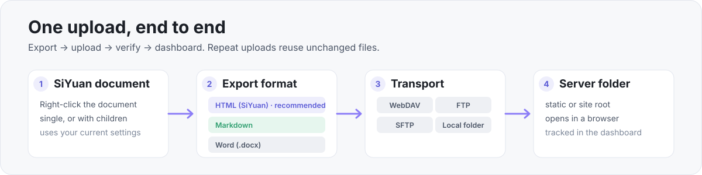
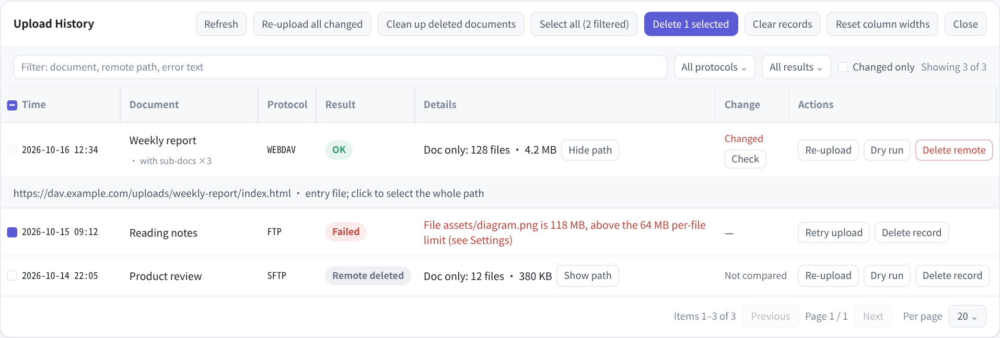

  

<h1 align="center">Netglimmer Upload</h1>

  SiYuan documents → WebDAV / FTP / SFTP servers or a local folder 
  One right-click exports and uploads as HTML, Markdown or Word — incremental, verified, tracked.

  
  
  
  

  <a href="README.md">简体中文</a> ·
  <strong>English</strong> ·
  <a href="README_en_US.md">Full English manual</a> ·
  <a href="README_zh_CN.md">完整中文手册</a>

  

Right-click a document in SiYuan. The plugin exports it with your current settings, uploads to the server or local folder, reads files back for verification, and records the result in the upload dashboard. Repeat uploads are incremental — only files that changed are sent.

| Capability | What it does |
|---|---|
| **Three formats** | A full HTML (SiYuan) page, Markdown plus referenced assets, or one self-contained Word (.docx) |
| **Incremental** | Skips runtime files already on the server; cleans up folders left behind by renames and moves |
| **Change detection** | After a document is edited again, the context menu adds "Changes detected — re-upload" |
| **Dry run & verify** | Preview file count and size before uploading; read files back afterwards; retry failures and cancel mid-run |
| **Dashboard** | Search, filter, sort, page through, bulk re-upload and remote cleanup; expand the upload path in place |
| **Three entry points** | Document tree context menu, command palette, status bar; no shortcut is bound by default |

## Three export formats

| Format | What lands in the remote folder | Best for |
|---|---|---|
| **HTML (SiYuan)** · recommended | `<doc>/index.html`, the `stage/` + `appearance/` runtime, and the `assets/` the body references | A complete page with theme, code highlighting, block references and embeds, images, plus an optional side outline |
| **Markdown** | `<doc>.md` and the `assets/` the body actually references | Static-site generators and Markdown readers |
| **Word (.docx)** | One self-contained `<doc>.docx` with images embedded | Handing to Word / WPS for further editing, or sending as an attachment |

> `index.html` is byte-identical to a manual "Export → HTML (SiYuan)". Markdown and Word use the SiYuan kernel's own export output.

## Four transports

| Protocol | Notes |
|---|---|
| **WebDAV** · recommended | Through SiYuan's kernel HTTP proxy; works with a standard WebDAV endpoint, no extra client |
| **FTP** | Built-in pure-JS client over a desktop socket, PASV; detects UTF-8 and falls back to GBK paths |
| **SFTP** | Built-in pure-JS SSH-2 / SFTP client, password auth; host keys pinned on first connect |
| **Local folder** | Writes to an absolute path on this machine — a local site directory or a mounted folder |

Each protocol keeps its own address, port, account and sub-directory; switching never overwrites another profile. An upload uses only the selected protocol.

## Upload dashboard

  

Illustrative UI · sample data, not a real upload history.

The dashboard records protocol, result, the document's own file count and size, remote path, and change state. The upload path expands in place; a record can be re-uploaded, retried, dry-run, or have its remote files removed. Bulk re-upload and remote cleanup apply to the current filtered set.

## Quick start

1. **Install** — Download the latest zip from [Releases](https://github.com/netglimmer/siyuan-plugin-netglimmer-Upload/releases), unzip it into `{workspace}/data/plugins/siyuan-plugin-netglimmer-Upload/`, and restart SiYuan. Desktop only.
2. **Configure** — Open "Settings → Loaded plugins → Netglimmer Upload". Start with **WebDAV + HTML (SiYuan)**, run "Test connection", then save.
3. **Upload** — Right-click any document → **Netglimmer One-Click Upload**. The upload appears in the dashboard; after the document is edited again, the menu adds "Changes detected — re-upload".

## Boundaries

The plugin only uploads files to a server or a local folder. It does not deploy a site, manage ports, or issue certificates — whether the folder is reachable in a browser, and at which domain, is the server's decision (IIS / nginx / a reverse proxy / a mount point).

| Works | Does not |
|---|---|
| WebDAV / FTP / SFTP / local folder | PDF export — the desktop PDF path is private IPC the plugin cannot call |
| HTML (SiYuan) / Markdown / Word | Mobile and browser editions of SiYuan |
| Incremental upload, change detection, dry run, dashboard, bulk actions | SFTP private-key auth; encrypted notebooks |

## Documentation

- [Full English manual](README_en_US.md): every setting, dashboard behavior, IIS / nginx notes, known limitations, source layout and packaging.
- [完整中文手册](README_zh_CN.md) · [中文首页](README.md)

## License

Released under **AGPL-3.0** — see [LICENSE](LICENSE). `src/vendored/index-html.js` contains front-end export code ported from [SiYuan](https://github.com/siyuan-note/siyuan); attribution is recorded in [NOTICE](NOTICE).
